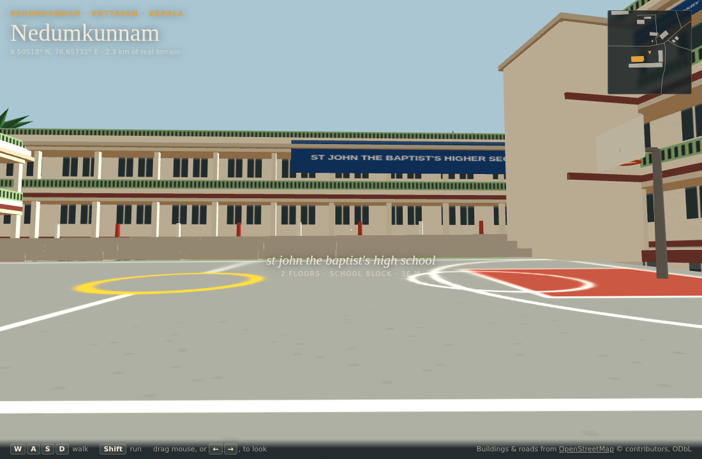
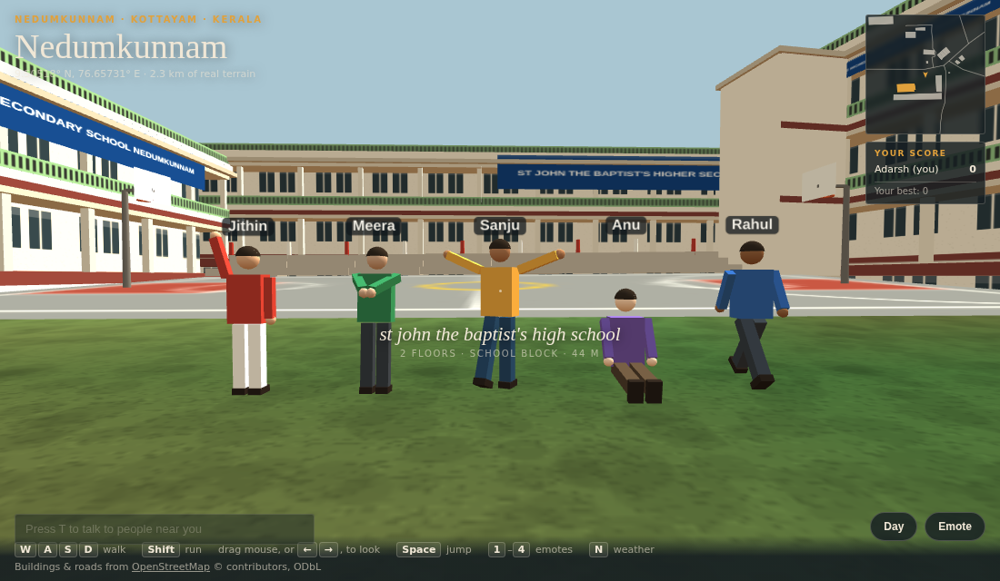
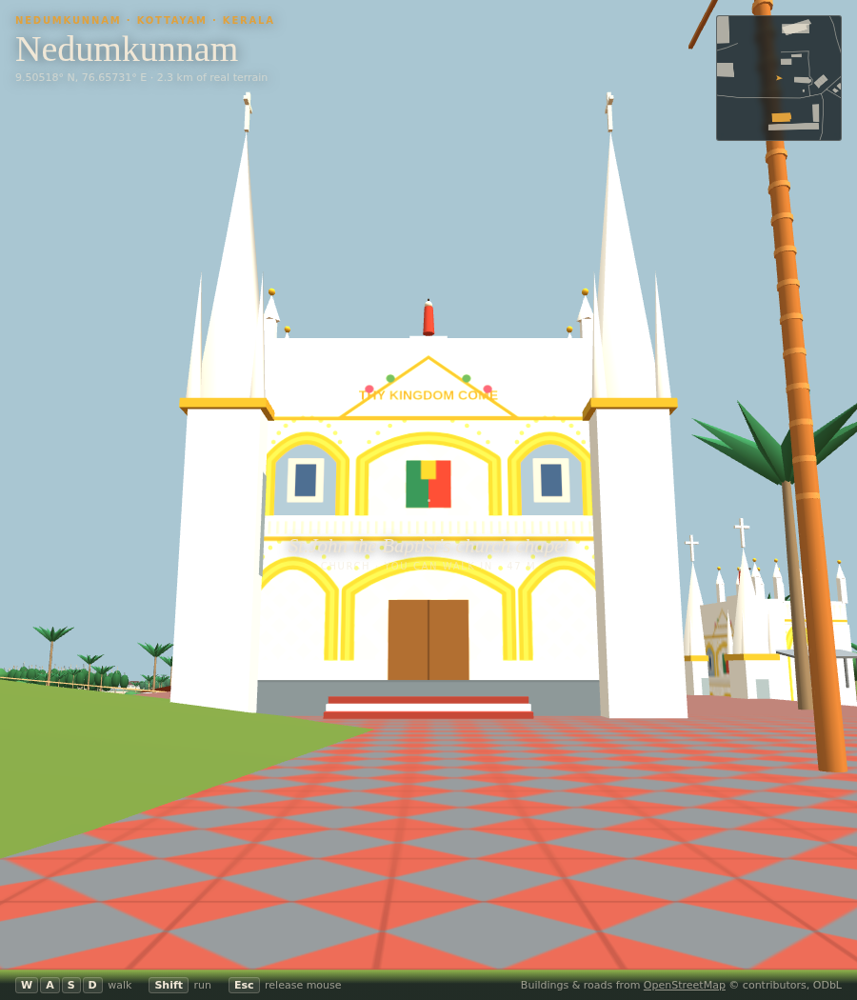
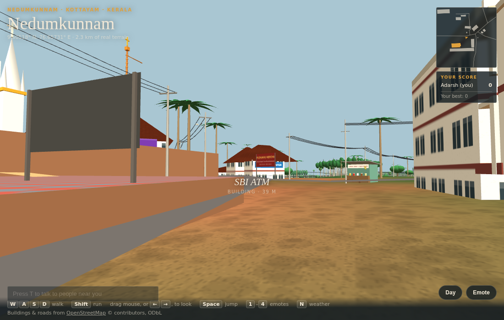
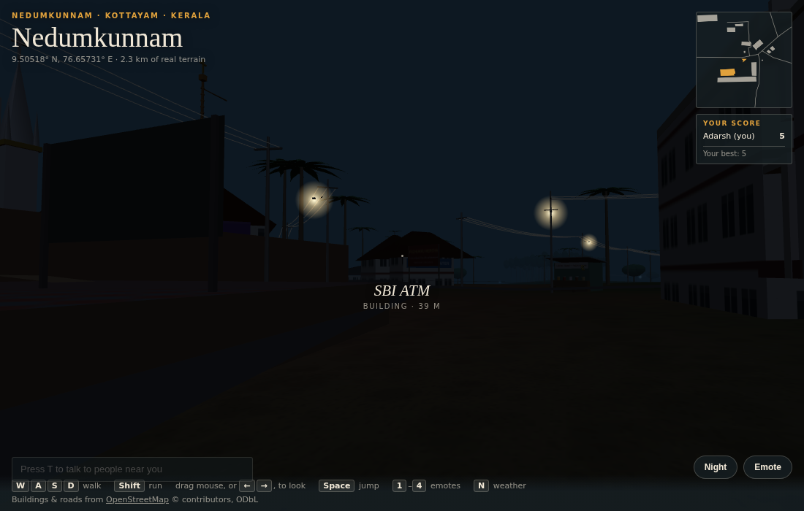

# Nedumkunnam World

Walk through Nedumkunnam, Kottayam, Kerala in 3D, together with friends:
St John the Baptist's HSS and its courtyard, the Forane Church and its
steps, the temples, and the village junction, all on the real hills.

## ▶ Play

| | Link | What works |
|---|---|---|
| **Play now** | **[ashisjkalathil.github.io/nedumkunnam-world](https://ashisjkalathil.github.io/nedumkunnam-world/)** | Walk the whole village solo, avatar maker, emotes, weather, collectibles |
| **Play with friends + voice** | [](https://render.com/deploy?repo=https://github.com/AshisJKalathil/nedumkunnam-world) | Everything above, plus multiplayer, proximity chat and **proximity voice** |

Works on phones and laptops. Nothing to install.

<!-- VOICE-LINK: once the Render service is live, replace the button above with
     its link, e.g. https://nedumkunnam-world.onrender.com -->



| | |
|---|---|
|  |  |
|  |  |

## Features

**The village**
- 123 buildings, 51 roads and 31 streams from OpenStreetMap, on 2.3 km of
  real SRTM terrain (47–154 m above sea level)
- **SJB HSS**: the U-shaped courtyard of three blocks, verandahs, green
  railings, the blue school banner, the basketball court and its gallery
- **Forane Church**: white-and-gold Gothic facade, two spires, walk-in
  interior with pews, copper kodimaram, and the climbable red-and-white
  stairway
- Kerala temples, the parish hall, the B.Ed college, shops with their real
  names
- Rubber on the slopes, coconut, areca, plantain, jack, mango and teak
  around the houses; laterite red soil
- Street life: electric poles with sagging wires, street lamps, the bus
  shelter, the chaya kada, flex boards, the "KARUKACHAL 3" milestone

**Playing**
- Avatar maker: your name, shirt, mundu or trousers, skin colour (saved on
  your device)
- Walk, run and jump; climb stairs and walk on floors and landings
- Emotes: wave, namaskaram, dance, sit
- Day, monsoon rain (with sound) and night (street lamps come on)
- 180 collectibles: mango (1 point), chembarathi (1), chakka (5). They
  come back after 2 minutes. Live scores for everyone present, and your
  personal best

**With friends** (Render version)
- See everyone's avatar walking around in real time, up to 64 players
- Proximity text chat with speech bubbles, and a "N people nearby" counter
- **Proximity voice**: you hear friends only when you're near them (30 m).
  Voices pan left and right as you turn and fade as people walk away

## Controls

| Laptop | Phone |
|---|---|
| **W A S D** walk, **Shift** run | Thumbstick to walk |
| Drag the mouse or **← →** to look | Drag anywhere to look |
| **Space** jump | **Jump** button |
| **1–4** wave, namaskaram, dance, sit | **Emote** button |
| **N** day / monsoon / night | **Day** button |
| **T** chat · **V** voice | Chat box · **Voice** button |

## Host it with voice (free, about 15 minutes)

1. **LiveKit** (carries the voice): sign up at
   [cloud.livekit.io](https://cloud.livekit.io), create a project, open
   **Settings → Keys**, and copy the **URL** (`wss://…livekit.cloud`), the
   **API key** and the **API secret**.
2. **Render** (hosts the world): press the **Deploy to Render** button
   above, or go to [render.com](https://render.com) → **New → Blueprint** →
   pick this repository. Paste the three LiveKit values when asked.
3. After a few minutes you get a link like
   `https://nedumkunnam-world.onrender.com`. Send it to your friends. Press
   **Voice** (or **V**), allow the microphone, and talk.

The free Render plan sleeps after 15 idle minutes; the first visitor waits
about a minute while it wakes. More detail: [server/README.md](server/README.md).

## Run it on your computer

Needs [Node.js](https://nodejs.org) 18 or newer.

```sh
cd server
npm install
npm start          # then open http://localhost:8080 in two windows
```

With voice:

```sh
LIVEKIT_URL=wss://... LIVEKIT_API_KEY=... LIVEKIT_API_SECRET=... npm start
```

Or just open `dist/index.html` in a browser for a solo walk.

To change the world, edit `src/` and run `./build.sh`. How it's built:
[docs/HOW-IT-WORKS.md](docs/HOW-IT-WORKS.md). Project notes:
[PROJECT_CONTEXT.md](PROJECT_CONTEXT.md).

## Credits

- Map data © [OpenStreetMap](https://www.openstreetmap.org/copyright)
  contributors, under the ODbL. `data/site.json` is derived from it and is
  also ODbL.
- Terrain: SRTM elevation data (NASA), via OpenTopoData.
- Built with [three.js](https://threejs.org) and [LiveKit](https://livekit.io).
